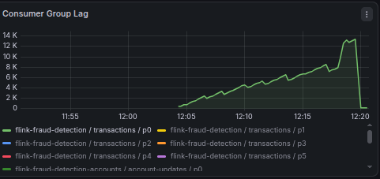
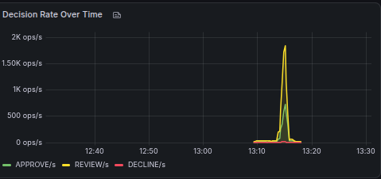
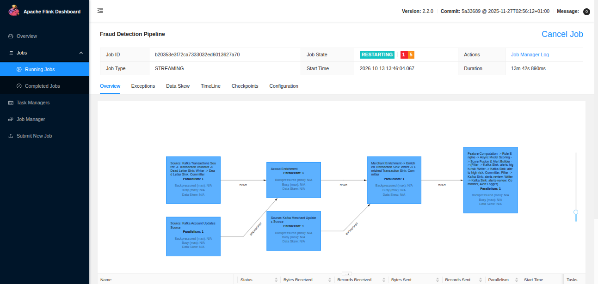
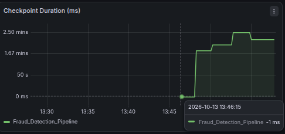
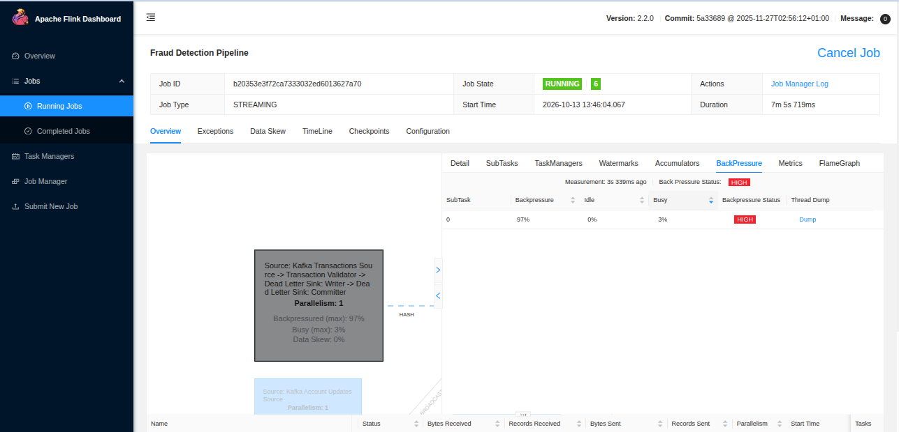

# Demo Scenarios

Guided demos that intentionally break things so you can watch the fraud detection pipeline respond. Each scenario demonstrates a real production failure mode and the system's resilience.

## Prerequisites

Start the full stack before running any demo:

```bash
make up && make wait-healthy && make setup
make deploy-jobs
make start-monitoring
make start-generator
```

Wait ~30 seconds for metrics to stabilize. Open these in your browser:
- **Grafana**: http://localhost:3000 (admin/admin) - three dashboards under "Fraud Detection" folder
- **Flink Web UI**: http://localhost:8082 - job status, backpressure, checkpoints
- **Prometheus**: http://localhost:9090 - raw metrics explorer

## Demo 1: Lag Spike

**What it does**: Floods the pipeline with 10x normal traffic (1000 TPS vs 100 TPS) for 30 seconds, creating a consumer lag spike visible on Grafana.

**What to watch**:
- Grafana > Kafka Overview > "Consumer Group Lag" — lag climbs during burst

    

- Grafana > Kafka Overview > "Messages In Per Second" — spike in ingestion rate
- After burst stops, lag drains as the pipeline catches up

**Run it**:

```bash
make demo-lag              # 30s burst (default)
bash demo/lag-spike.sh 60  # 60s burst
```

**Why it matters**: In production, traffic spikes happen during events (Black Friday, marketing campaigns). The pipeline needs to buffer and catch up without data loss. Kafka acts as a shock absorber — consumer lag is the pressure gauge.

## Demo 2: Model Outage

**What is does**: Kills the ML model service, forcing the pipeline to fall back to rule-only scoring. Restarts after 30 seconds and watches recovery.

**What to watch**:
- Grafana > Fraud Detection > "Decision Breakdown" — distribution shifts during outage

    

- Flink TaskManager logs: `docker logs -f flink-taskmanager 2>&1 | grep -i model`
- After restart, model scores resume and decision distribution normalizes

**Run it**:

```bash
make demo-model-down          # 30s outage (default)
bash demo/model-outage.sh 60  # 60s outage
```

**Why it matters**: External service dependencies fail. The pipeline's async model scoring has a timeout and fallback — when the model is unavailable, scoring continues with rules only. This is a graceful degradation pattern: reduced accuracy, but zero downtime.

## Demo 3: Checkpoint Recovery

**What is does**: Kills the Flink TaskManager container, causing the running job to fail. The JobManager detects the loss, and when a new TaskManager starts, the job restarts from the last checkpoint with all state restored.

**What to watch**:
- Flink Web UI > Jobs — job goes from RUNNING -> RESTARTING -> RUNNING

    
    

- Checkpoint restore info shown in script output
- Grafana > Flink Jobs > "Checkpoint Duration" — checkpoints resume after recovery

    

**Run it**:

```bash
make demo-recovery
```

**Why it matters**: Worker nodes crash in production. Flink's checkpointing ensures exactly-once processing guarantees are maintained across failures. The broadcast state (account/merchant data), keyed state (feature windows), and Kafka consumer offsets are all restored from the checkpoint. No data is lost or duplicated.

## Demo 4: Backpressure

**What is does**: Throttles the Flink TaskManager's CPU to 10%, creating backpressure that propagates upstream through the pipeline.

**What to watch**:
- Flink Web UI > Running Job > Task details — backpressure indicators turn red

    

- Grafana > Flink Jobs > "Backpressure (ms/s)" — values rise from 0
- Grafana > Kafka Overview > "Consumer Group Lag" — lag grows as throughput drops

**Run it**:

```bash
make demo-backpressure           # 30s throttle (default)
bash demo/backpressure.sh 60     # 60s throttle
```

**Why it matters**: Backpressure is how Flink communicates "slow down" to upstream operators. In production, backpressure can be caused by slow external calls, GC pauses, or resource contention. Monitoring backpressure is essential for capacity planning and identifying bottlenecks.

## Cleanup

If a demo leaves things in a bad state:

```bash
make down
```

## Running All Demos

Run them in order, waiting ~30 seconds between each for metrics to stabilize:

```bash
make demo-lag
# wait 30s
make demo-model-down
# wait 30s
make demo-backpressure
# wait 30s
make demo-recovery
```

Run checkpoint recovery last since it restarts the TaskManager.