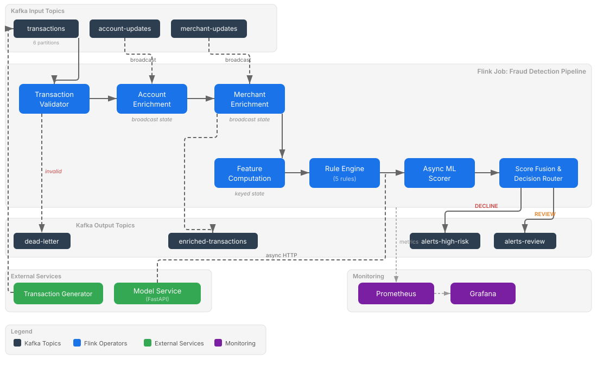

# Architecture

## Pipeline Overview



The fraud detection pipeline is a single Flink job that reads from three Kafka topics, processes transactions through seven operator stages and writes to four output topics. Everything runs in a single TaskManager with four task slots for local development.

## Data Flow

A transaction takes this path through the pipeline:

1. **Generator** produces an Avro-encoded `Transaction` to the `transaction` topic
2. **TransactionValidator** checks for null IDs, negative amounts and timestamp sanity. Invalid records go to the `dead-letter` topic as JSON strings via a side output
3. **AccountBroadcastFunction** enriches the transaction with account data (type, status, risk score) from broadcast state
4. **MerchantBroadcastFunction** adds merchant data (category, risk level, blacklist flag) from a second broadcast state
5. The enriched transaction is written to the `enriched-transactions` topic
6. **AccountFeatureFunction** computes per-account features: rolling average, standard deviation, velocity count, time since last transaction, distance from last location
7. **RuleEngineFunction** applies five fraud detection rules, each producing a score from 0.0 to 1.0
8. **AsyncModelClient** sends the scored transaction to the ML model service via HTTP and attaches the returned fraud probability
9. **AlertBuilder** fuses rule and model scores into a single risk score, makes an approve/review/decline decision and writes `FraudAlert` records to `alerts-high-risk` or `alerts-review`

The main pipelien class is `FraudDetectionPipeline` in the `pipeline` module. It wires all stages together:

```java
// Validation with dead-letter side output
SingleOutputStreamOperator<Transaction> validTransactions = transactions
        .process(new TransactionValidator())
        .name("Transaction Validator");

// Account enrichment via broadcast join
SingleOutputStreamOperator<EnrichedTransaction> accountEnriched = validTransactions
        .keyBy(Transaction::getAccountId)
        .connect(accountBroadcast)
        .process(new AccountBroadcastFunction())
        .name("Account Enrichment");

// Feature computation, rule engine, model scoring, alert generation
DataStream<FeatureVector> features = enrichedTransactions
        .keyBy(EnrichedTransaction::getAccountId)
        .process(new AccountFeatureFunction())
        .name("Feature Computation");
```

## Enrichment Pattern

Reference data (accounts and merchants) arrives on separate Kafka topics and gets broadcast to all parallel instances of the enrichment operators. This is Flink's broadcast state pattern - every parallel subtask holds a complete copy of the lookup table.

Two sequential broadcast joins enrich each transaction:
1. **Account enrichment** - keyed by `account_id`, broadcasts `Account` records into a `MapStateDescriptor<String, Account>`. When a transaction arrives, the function looks up the account and copies `account_type`, `account_status` and `account_risk_score` onto the output.
2. **Merchant enrichment** - re-keyed by `merchant_id`, broadcasts `Merchant` records. Adds `merchant_category`, `merchant_risk_level` and `is_blacklisted`.

The two joins are sequential rather than combined because each requires a different key. Account enrichment keys the transaction stream by `account_id` and merchant enrichment re-keys by `merchant_id`. Flink's `KeyedBroadcastProcessFunction` requires a keyed stream on the non-broadcast side.

```java
public class AccountBroadcastFunction
        extends KeyedBroadcastProcessFunction<String, Transaction, Account, EnrichedTransaction> {

    public static final MapStateDescriptor<String, Account> ACCOUNT_STATE =
            new MapStateDescriptor<>("account-state", Types.STRING, new AvroTypeInfo<>(Account.class));

    @Override
    public void processElement(Transaction tx, ReadOnlyContext ctx,
                               Collector<EnrichedTransaction> out) throws Exception {
        Account account = ctx.getBroadcastState(ACCOUNT_STATE).get(tx.getAccountId());
        EnrichedTransaction enriched = buildEnrichedTransaction(tx, account);
        out.collect(enriched);
    }

    @Override
    public void processBroadcastElement(Account account, Context ctx,
                                        Collector<EnrichedTransaction> out) throws Exception {
        ctx.getBroadcastState(ACCOUNT_STATE).put(account.getAccountId(), account);
    }
} 
```

If no account or merchant data exists for a given ID, the enrichment fields are left null. The pipeline does not block waiting for reference data - it enriches with whatever is available.

## Feature Computation

`AccountFeatureFunction` is a `KeyedProcessFunction` keyed by `account_id`. It maintains eight pieces of state per account:

| **State** | **Type** | **Purpose** |
|-|-|-|
| `tx-count` | `ValueState<Long>` | Lifetime transaction count |
| `tx-sum` | `ValueState<Double>` | Lifetime sum of amounts |
| `tx-sum-squares` | `ValueState<Double>` | Sum of squared amounts (for stddev) |
| `recent-timestamps` | `ListState<Long>` | Timestamps in the velocity window |
| `last-timestamp` | `ValueState<Long>`	| When the last transaction occurred |
| `last-lat` | `ValueState<Double>` | Last known latitude |
| `last-lon` | `ValueState<Double>` | Last known longitude |
| `next-timer` | `ValueState<Long>` | Next cleanup timer timestamp |

From this state the function computes a `FeatureVector` for each transaction:
- **txCountInWindow** - number of transactions in the last 5 minutes (velocity)
- **avgAmount** - running average of all transaction amounts
- **stdDevAmount** - population standard deviation (computed from running sums, not stored history)
- **msSinceLastTx** - milliseconds since the previous transaction (-1 if first)
- **distanceFromLastKm** - Haversine distance in km from the last transaction's location
- **impossibleTravel** - boolean flag if the implied travel speed exceeds 900 km/h

A processing-time timer fires every 60 seconds to evict expired timestamps from the `recent-timestamps` list, preventing unbounded state growth.

The `computeStdDev` function computes standard deviation from running sums using the identity `Var(X) = E[X^2] - (E[X])^2`, avoiding the need to store full transaction history.

```java
static double computeStdDev(double sumSquares, double sum, long count) {
    if (count < 2) return 0.0;
    double variance = (sumSquares / count) - (sum / count) * (sum / count);
    return variance > 0 ? Math.sqrt(variance) : 0.0;
}
```

## Rule Engine

Five rules implement the `FraudRule` interface. Each receives a `FeatureVector` and returns a `RuleResult` with a name, score (0.0 to 1.0) and explanation string.

```java
public interface FraudRule extends Serializable {
    RuleResult evaluate(FeatureVector featureVector);
}
```

`RuleEngineFunction` applies all five rules to each feature vector and collects the scores into a `ScoredTransaction`.

### VelocityRule

Detects high transaction frequency. If more than 5 transactions occur within the 5-minute velocity window, the score starts at 0.5 and increases by 0.1 per additional transaction, capped at 1.0.

### GeoAnomalyRule

Flags impossible travel. Uses the Haversine distance and time between consecutive transactions to estimate travel speed. Either distance below 50 km *or* time is not positive *or* speed above 900 km/h score 0.9 (impossible travel). Distance above 500 km within 2 hours scores 0.5 (suspicious).

### AmountThresholdRule

Detects statistical outliers. Computes the z-score of the current transaction amount against the account's rolling average and standard deviation. Z-score above 3.0 scores 0.9, above 2.0 scores 0.5, above 1.5 scores 0.2.

### CardTestingRule

Identifies card testing patterns - rapid sequences of micro-transactions used to validate stolen card numbers. Amount below $1.00 with more than 3 transactions in the window scores 0.8. Amount below $5.00 with more than 5 scores 0.6.

### BlacklistRule

Checks enrichment data for known bad actors. Blacklisted merchant scores 1.0. Suspended account scores 0.7. Merchant with HIGH risk level scores 0.4. The highest matching condition wins.

## ML Integration

AsyncModelClient uses Flink's async I/O to call the model service without blocking the pipeline. The key design decisions:
- **Unordered wait**. `AsyncDataStream.unorderedWait` allows results to return in any order. This maximizes throughput at the cost of output ordering - acceptable here because the downstream score fusion does not depend on transaction ordering.

	```java
	DataStream<ScoredTransaction> modelScored = AsyncDataStream.unorderedWait(
			scored,
			new AsyncModelClient(),
			PipelineConfig.modelTimeoutMs(), // 2000ms default 
			TimeUnit.MILLISECONDS,
			PipelineConfig.modelMaxConcurrent()) // 100 concurrent requests
			.name("Async Model Scoring");
	```

- **Timeout fallback**. If the model service does not respond within 2 seconds (or returns an error), modelScore remains null. The score fusion layer detects this and falls back to rules-only scoring with renormalized weights. The pipeline never stops processing due to model unavailability.
- **Capacity limit**. At most 100 requests are in flight simultaneously. If the pipeline produces transactions faster than the model can score them, Flink applies backpressure upstream rather than overwhelming the model service.

The model service itself is a FastAPI application serving a scikit-learn classifier. It accepts transaction features and rule scores as input and returns a fraud probability between 0.0 and 1.0.

## Score Fusion

`WeightedScoreFusion` combines rule scores and the model score into a single risk score using fixed weights:

| **Source** | **Weight** |
|-|-|
| Velocity rule | 0.15 |
| Geo anomaly rule | 0.20 |
| Amount threshold rule | 0.15 |
| Card testing rule | 0.10 |
| Blacklist rule | 0.20 |
| ML model | 0.20 |

The fused score is a weighted average:

```
fusedScore = (sum of score_i * weight_i) / (sum of weight_i)
```

When the model score is `null` (timeout or service down), the model weight is excluded and the remaining rule weights are renormalized:

```java
if (scored.modelScore != null) {
    double totalWeight = ruleWeightSum + W_MODEL;
    return (ruleSum + scored.modelScore * W_MODEL) / totalWeight;
} else {
    return ruleSum / ruleWeightSum;
}
```

This renormalization means the pipeline produces slightly different scores during a model outage, but never stops making decisions.

## Decision Routing

`DecisionRouter` maps the fused score to a decision using two configurable thresholds:

| **Score Range** | **Decision** | **Destination Topic** |
|-|-|-|
| < 0.3 | APPROVE | (no output - approved transactions are not routed) |
| 0.3 - 0.7 | REVIEW | `alerts-review` |
| >= 0.7 | DECLINE | `alerts-high-risk` |

`AlertBuilder` ties everything together. For each transaction it:
1. Calls `WeightedScoreFusion.fuse()` to compute the final score
2. Calls `DecisionRouter.route()` to determine the decision
3. Identifies the highest-contributing rule as the `AlertType`
4. Generates a human-readable explanation via `ExplanationBuilder`
5. Builds a `FraudAlert` Avro record
6. Increments custom Flink counters for monitoring

The alert type reflects which scoring source contributed most. If the model score is the highest individual score, the type is `MODEL_HIGH_RISK`. Otherwise it maps to the highest-scoring rule (e.g. `VELOCITY`, `BLACKLIST`).

## Serialization

All Kafka messages use Avro with Confluent Schema Registry. Five schemas are defined in the `schemas/` directory:

| **Schema** | **Topics** |
|-|-|
| `transaction.avsc` | `transactions` |
| `account.avsc` | `account-updates` |
| `merchant.avsc` | `merchant-updates` |
| `enriched-transaction.avsc` | `enriched-transactions` |
| `fraud-alert.avsc` | `alerts-high-risk`, `alerts-review` |

`AvroSerdeFactory` in the `common` module provides generic factory methods for creating Kafka sources and sinks with the correct serialization configuration. Subject naming follows the `{topic}-value` convention.

## Checkpointing and Fault Tolerance

The pipeline runs with exactly-once checkpointing at 10-second intervals. State is stored in the hashmap backend (in-memory, suitable for development). The restart strategy allows up to 30 attempts with 10-second delays.

On a TaskManager failure:
1. The JobManager detects the lost TaskManager
2. When a new TaskManager registers, the job restarts from the last completed checkpoint
3. All operator state is restored - broadcast state (account/merchant lookup tables), keyed state (per-account features and statistics) and Kafka consumer offsets
4. Processing resumes from the checkpointed Kafka offsets with no data loss or duplication

The `demo-recovery` demo script shows this in action by killing the TaskManager container and watching the automatic recovery.