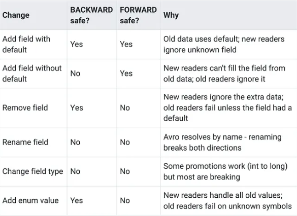
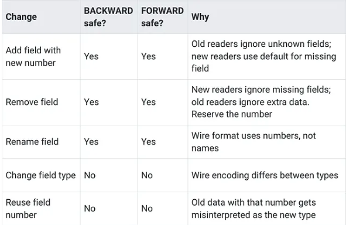

# The Schema Change That Broke Production: Safe Evolution in Streaming

Link: https://medium.com/@blakelassiter/the-schema-change-that-broke-production-safe-evolution-in-streaming-508a2b3febbd

## Why Schema Matters More in Streaming

In batch systems, schema-on-read is common. You dump data into a lake, figure out the structure when you query it. If a column changes type, you update your query or transformation and reprocess. The feedback loop is slow but forgiving.

Streaming systems enforce schema-on-write. The producer serializes each message against a schema before sending it to Kafka. The consumer deserializes using its own copy of the schema. If those two schemas are incompatible, deserialization fails. And in a streaming pipeline, deserialization failures aren’t something you can quietly fix and re-run.
- Messages back up, consumer lag grows and alerts fire. If the consumer is a Flink job maintaining state for fraud detection, every minute of lag is a minute where fraudulent transactions go undetected.

The core challenge is version coexistence. During any rolling deployment, some producer instances are running old code with schema v1 while others have already restarted with schema v2. The Kafka topic contains a mix of both and consumers might be on either version. The schema needs to handle all four combinations: old producer to old consumer, old producer to new consumer, new producer to old consumer, new producer to new consumer.
- Batch systems sidestep this by processing data in discrete runs. Streaming systems don’t get that option.

## Choosing a Serialization Format

The serialization format determines how messages are encoded, how schemas are stored and what kinds of changes are safe. Avro, Protobuf and JSON Schema dominate the Kafka ecosystem, each with different tradeoffs for evolution.
- **[Avro](https://avro.apache.org/docs/++version++/specification/)** is Schema Registry’s native format and the most common choice for Kafka. Messages are compact binary, with the schema stored separately in the registry rather than embedded in each message. Each message carries only a 5-byte header (a magic byte plus a 4-byte schema ID). The consumer fetches the schema from the registry by ID, caches it and uses it for deserialization. Avro has the richest evolution support of the three formats, with explicit rules for which changes are backward-compatible and which are breaking. The tradeoff is that schemas must be registered before producing.
- **[Protobuf](https://protobuf.dev/)** uses generated code from .proto files and strong typing. Where Avro identifies fields by name, Protobuf identifies them by number - which means renaming a field is safe (the wire format never sees names) but reusing a field number will silently misinterpret old messages. If your schemas need to work across both Kafka and gRPC services, Protobuf's broader ecosystem support makes it a natural fit. [Schema Registry setup](https://docs.confluent.io/platform/current/schema-registry/fundamentals/serdes-develop/serdes-protobuf.html) requires slightly more configuration than Avro.
- **[JSON Schema](https://json-schema.org/)** trades compactness for readability. You can inspect messages with a console consumer and no extra tooling, which makes debugging significantly easier. The cost is weaker evolution support, larger messages (field names repeated in every message) and less rigid schema enforcement — no binary encoding and no field numbering mean accidental breaking changes slip through more easily.

For our fraud detection pipeline, Avro with Schema Registry is the right choice. The combination of compact encoding, native Kafka integration and strong evolution rules outweighs the upfront cost of schema registration. The rest of this article focuses on Avro, though the compatibility concepts apply across all three formats.

## Schema Registry: The Coordination Layer

Schema Registry stores schemas organized by **subject**. By default, each Kafka topic has two subjects: `<topic>-value` for the message value schema and `<topic>-key` for the key schema. Our fraud detection pipeline's transaction topic uses the subject `transactions-value` for its Avro schema.

When a producer serializes a message, it registers the schema with the registry (or looks up the ID if the schema is already registered). The registry returns a numeric schema ID that the producer prepends to the serialized message bytes. Deserialization works in reverse: the consumer reads that schema ID from the message header, fetches the corresponding schema from the registry and uses it to decode the payload. After the first lookup for a given ID, the schema gets cached locally.

Understanding schema evolution requires distinguishing between the **writer schema** and the **reader schema**. The writer schema is whatever the producer used to serialize a given message — identified by the schema ID in the message header. The reader schema is the one the consumer was compiled against. [Avro’s schema resolution rules](https://avro.apache.org/docs/++version++/specification/#schema-resolution) reconcile differences between the two at deserialization time. Fields present in the writer but absent from the reader get ignored. Fields the reader expects but the writer didn’t include get populated from their default values — assuming defaults exist. Without a default, deserialization fails.

The registry also enforces compatibility rules. Before accepting a new schema version, it checks the proposed schema against existing versions according to the configured compatibility mode. If the check fails, registration is rejected. In production, this check typically happens in CI/CD. Schema registration failures should block deployment, not surface at runtime.

```java
// Schema Registry client for programmatic schema management.
// In production, schema registration typically happens in CI/CD pipelines
// rather than at runtime.
SchemaRegistryClient schemaRegistry = new CachedSchemaRegistryClient(
    "http://schema-registry:8081",
    100  // schema cache capacity
);

// Register a new schema version for the transactions topic value
String subject = "transactions-value";
int schemaId = schemaRegistry.register(subject, new AvroSchema(transactionSchema));

// Test compatibility before registering - useful in CI/CD gates
boolean isCompatible = schemaRegistry.testCompatibility(
    subject, new AvroSchema(updatedSchema)
);
```

## Compatibility Modes

The compatibility mode configured for each subject determines which schema changes the registry will accept.

### BACKWARD Compatibility (the default)

With BACKWARD compatibility, new consumers can read data written by old producers. That means you upgrade consumers first, then producers. New consumers handle both old and new message formats, while old consumers never encounter new-format messages because producers haven’t changed yet.

Allowed changes under BACKWARD: adding fields with default values, removing fields. The new consumer ignores removed fields and uses defaults for added ones when reading old messages.

Breaking changes under BACKWARD: adding required fields without defaults, changing field types. Old messages can’t satisfy a new required field that didn’t exist when they were written.

### FORWARD Compatibility

The previous schema version can read data written with the new schema version. This is the reverse — you can safely upgrade producers first, then upgrade consumers. Old consumers handle new-format messages by ignoring unknown fields.

Adding fields is safe under FORWARD because old consumers ignore them, and removing optional fields with defaults also works. But removing required fields breaks old consumers that still expect them, and changing field types is dangerous in either direction.

### FULL Compatibility

FULL compatibility requires both BACKWARD and FORWARD simultaneously — schemas must be bidirectionally compatible. You can deploy producers and consumers in either order. This is the most restrictive mode because every change must be safe in both directions, and only changes that satisfy both BACKWARD and FORWARD rules are accepted.

For our fraud detection pipeline, FULL compatibility is the right default. During an incident, you don’t want to worry about which service needs to be deployed first.

### TRANSITIVE Variants

Standard compatibility modes (BACKWARD, FORWARD, FULL) only check the new schema against the immediately previous version. The [TRANSITIVE variants](https://docs.confluent.io/platform/current/schema-registry/fundamentals/schema-evolution.html#transitive-property) (BACKWARD_TRANSITIVE, FORWARD_TRANSITIVE, FULL_TRANSITIVE) check against all previous versions in the subject.

Use TRANSITIVE when consumers might be more than one version behind. In a large organization where teams don’t all deploy simultaneously, FULL_TRANSITIVE prevents a chain of individually-compatible changes from creating an incompatibility gap between versions that are two or three steps apart.

```bash
# Check the current compatibility mode for a subject
curl http://schema-registry:8081/config/transactions-value

# Set FULL_TRANSITIVE for critical fraud detection topics
curl -X PUT -H "Content-Type: application/vnd.schemaregistry.v1+json" \
  --data '{"compatibility": "FULL_TRANSITIVE"}' \
  http://schema-registry:8081/config/transactions-value
```

For the fraud detection pipeline, FULL_TRANSITIVE on the `transactions-value` subject is the safest choice. It's the most restrictive mode, but that restriction is the point. When schema compatibility failures happen, they should happen at registration time in CI/CD - not at 3 AM in production.

## Breaking vs Non-Breaking Changes

The rules for safe changes differ by format and compatibility mode.

The scenario is always the same: you register a new version of the schema in Schema Registry and deploy an updated producer that writes messages using that new version. The question is what breaks. “BACKWARD safe” means existing consumers can still read the new messages without redeployment. “FORWARD safe” means the old producers’ messages (still sitting in the topic) remain readable by consumers that have already upgraded to the new schema. A change that’s safe in both directions is FULL compatible.

### Avro Evolution Rules



Avro does allow a specific set of type promotions: `int` can widen to `long`, `float` or `double`. `long` can widen to `float` or `double`. `float` can widen to `double`. These are BACKWARD compatible - a new consumer expecting `long` can safely read old messages that contain `int`. The reverse doesn't work. An old consumer expecting `int` can't safely read `long` values that might exceed int's range, so widening is not FORWARD compatible. Under FULL compatibility, widening is a breaking change.

### Protobuf Evolution Rules

Protobuf’s [evolution model](https://protobuf.dev/programming-guides/proto3/#updating) works differently because the wire format uses field numbers rather than names.



The contrast with Avro stands out. Protobuf’s results are almost entirely symmetric — Yes/Yes or No/No — because its number-based wire format handles both directions the same way. Avro’s name-based resolution creates directional splits where a change is safe for one side but breaks the other.

The rows differ between the two tables because each format has risks the other doesn’t. Avro has no field numbers to reuse, so that row doesn’t apply. Protobuf (proto3) assigns implicit defaults to every field, so “add field without default” isn’t possible. Enum handling also differs — Avro’s closed enums break old readers on new values, while proto3’s open enums preserve unknown values by default.

Protobuf’s number-based identity has a flip side. Renames are free (something that always breaks Avro), but field number reuse is catastrophic. Remove field 7, then later add a completely different field 7 — and old messages carrying the original field 7 will silently deserialize as the new type. No error, no warning, just corrupted data. The [reserved](https://protobuf.dev/programming-guides/proto3/#reserved) keyword exists specifically to prevent this: mark removed field numbers as reserved so the compiler rejects any attempt to reuse them.

### JSON Schema Evolution

JSON Schema’s evolution behavior is less rigidly defined than Avro or Protobuf. Fields are matched by name (like Avro), messages are self-describing (field names travel with every message) and there’s no binary encoding to enforce type boundaries. Adding optional fields is generally safe in both directions. Removing fields or changing types depends on how strictly consumers validate incoming messages — a consumer using lenient parsing might tolerate changes that would break a strict validator. Schema Registry does enforce compatibility checks for JSON Schema subjects, but the format’s flexibility means more responsibility falls on the developer to avoid subtle incompatibilities. For pipelines where evolution safety is critical, Avro or Protobuf provide stronger guardrails.

## Evolution Patterns

### Adding Fields Safely

Always add new fields with a default value. For Avro, use a union with null:

```
{
  "name": "risk_score",
  "type": ["null", "double"],
  "default": null,
  "doc": "ML model risk score, added in schema v3"
}
```

The union type `["null", "double"]` means the field can be either null or a double. The `"default": null` means old messages (written before this field existed) will deserialize with `risk_score` set to null. This is FULL compatible because new consumers reading old messages get null and old consumers reading new messages ignore the unfamiliar field.

### Deprecating Before Removing

Removing a field immediately is safe under BACKWARD compatibility but breaks FORWARD compatibility. If you can’t guarantee that all consumers are upgraded before any producer stops writing the field, use a staged approach:
1. Mark the field as deprecated in schema documentation
2. Stop populating it in producers (write null or the default value)
3. Update all consumers to handle the missing field gracefully
4. Remove the field from the schema in a subsequent version

This staged process takes longer but eliminates the risk of a consumer failing because it expects a field that no longer exists.

### Widening Types

The type promotion chain mentioned earlier (`int` to `long` to `float` to `double`) is backward-compatible but not forward-compatible. If our transaction amount field started as `int` (cents) and needs to support larger values:

Schema v1: amount as int (sufficient for small transactions)

```
{"name": "amount", "type": "int"}
```

Schema v2: amount as long (supports larger values)

```
{"name": "amount", "type": "long"}
```

Old messages with `int` amounts deserialize correctly as `long` - this is backward-compatible. But under FULL compatibility, widening is breaking because the reverse (long to int) isn't safe. If your subject uses FULL_TRANSITIVE, you'll need the versioned topic approach instead. Either way, it's a one-way door. Once you widen the type, you can't narrow it back.

### The Versioned Topic Escape Hatch

When you genuinely need a breaking change that can’t be handled through evolution — restructuring the record, splitting one topic into two, changing the fundamental shape of the data — create a new topic with a new schema:
1. Create `transactions-v2` with the new schema
2. Update producers to write to the new topic
3. Run consumers on both topics during the transition
4. Migrate consumers to the new topic
5. Decommission the old topic after its retention period expires

This is the most disruptive option. It works but adds operational complexity and a temporary period of dual consumption. Use it only when evolution patterns can’t get you where you need to go.

## Producer-Consumer Version Skew

During rolling deployments, multiple schema versions are active simultaneously. Understanding which compatibility mode protects which deployment order prevents the kind of scramble that turns a routine deployment into an incident.

Consider a rolling producer update:
- **T0**: All producers on schema v1, all consumers on schema v1. Everything works.
- **T1**: First producer instance restarts with schema v2. The topic now contains a mix of v1 and v2 messages.
- **T2**: More producers restart. The mix shifts toward v2.
- **T3**: All producers on v2. But some consumers might still be on v1.

Under BACKWARD compatibility, the new schema can read old data but old consumers can’t read new data. That means consumers must be upgraded before producers. If you deploy producers first (as in this scenario), old consumers fail on v2 messages.

Under FORWARD compatibility, old consumers can read new data, so deploying producers first is safe.

FULL compatibility covers both directions, meaning either deployment order works.

**The deployment order rule**:
- BACKWARD: upgrade consumers first, then producers
- FORWARD: upgrade producers first, then consumers
- FULL: either order works

## Practical Application: Evolving the Fraud Detection Schema

Returning to the fraud detection pipeline, adding `device_fingerprint` to the transaction schema for mobile fraud detection.

The original schema:

```
{
  "type": "record",
  "name": "Transaction",
  "namespace": "com.frauddetection",
  "fields": [
    {"name": "transaction_id", "type": "string"},
    {"name": "account_id", "type": "string"},
    {"name": "amount", "type": "double"},
    {"name": "timestamp", "type": "long"}
  ]
}
```

The evolved schema with `device_fingerprint`:

```
{
  "type": "record",
  "name": "Transaction",
  "namespace": "com.frauddetection",
  "fields": [
    {"name": "transaction_id", "type": "string"},
    {"name": "account_id", "type": "string"},
    {"name": "amount", "type": "double"},
    {"name": "timestamp", "type": "long"},
    {"name": "device_fingerprint", "type": ["null", "string"], "default": null}
  ]
}
```

The point is the union type with null and the default value. This makes the change FULL compatible — new consumers reading old messages get `device_fingerprint` as null, while old consumers reading new messages simply ignore the unfamiliar field.

The deployment sequence:
1. Register the v2 schema against `transactions-value`. With FULL_TRANSITIVE configured, the registry validates that v2 is compatible with all previous versions before accepting it.
2. Deploy the updated Flink job. It handles null `device_fingerprint` values for old transactions and populated values for new ones.
3. Deploy updated producers that populate `device_fingerprint` when available.
4. Old transactions continue flowing with null fingerprints while new transactions carry the device data, with no downtime or deserialization failures.

The Flink job handles the transition by treating null as a signal that the data predates the schema change:

```java
// ProcessFunction that handles schema evolution gracefully.
// Assumes: input stream is keyed by account_id and deserialized
// using ConfluentRegistryAvroDeserializationSchema, which handles
// writer/reader schema resolution automatically.
public class DeviceFingerprintEnricher
        extends ProcessFunction<Transaction, EnrichedTransaction> {

    @Override
    public void processElement(
            Transaction tx,
            Context ctx,
            Collector<EnrichedTransaction> out) {

        EnrichedTransaction enriched = new EnrichedTransaction(tx);

        // device_fingerprint is null for transactions written before schema v2.
        // Use a neutral risk score for those - don't penalize or pass them through
        // without scoring.
        String fingerprint = tx.getDeviceFingerprint();
        if (fingerprint != null) {
            enriched.setDeviceRiskScore(lookupDeviceRisk(fingerprint));
        } else {
            enriched.setDeviceRiskScore(0.5);  // Neutral - neither safe nor risky
        }

        out.collect(enriched);
    }

    // In production, this would call a device risk service or consult
    // a local cache of known device fingerprints.
    private double lookupDeviceRisk(String fingerprint) {
        // Placeholder for device risk lookup
        return 0.3;
    }
}
```

The Flink Kafka source handles schema evolution transparently when using Avro with Schema Registry. The [ConfluentRegistryAvroDeserializationSchema](https://nightlies.apache.org/flink/flink-docs-stable/api/java/org/apache/flink/formats/avro/registry/confluent/ConfluentRegistryAvroDeserializationSchema.html) fetches the writer schema from the registry based on the schema ID in each message and resolves it against the reader schema compiled into the Flink job. As long as the schemas are compatible, deserialization succeeds regardless of which version produced the message.

```java
// Flink Kafka source with Schema Registry integration.
// The deserializer handles schema evolution automatically -
// messages written with any compatible schema version are
// deserialized correctly against Transaction.class.
KafkaSource<Transaction> source = KafkaSource.<Transaction>builder()
    .setBootstrapServers("kafka:9092")
    .setTopics("transactions")
    .setGroupId("fraud-detection")
    .setValueOnlyDeserializer(
        ConfluentRegistryAvroDeserializationSchema.forSpecific(
            Transaction.class,
            "http://schema-registry:8081"
        )
    )
    .build();
```

There’s a practical wrinkle here — Flink jobs compile against a specific version of the generated Avro classes. When you evolve the schema and want the Flink job to populate the new fields (not just tolerate their absence), you need to redeploy the job with updated generated classes. The schema evolution handling lets the job keep running during the transition, reading both old and new messages. But taking advantage of the new field requires a code change and redeployment.