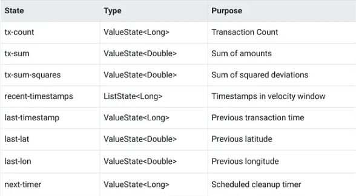
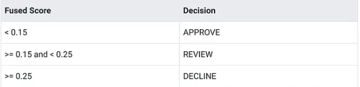

# Building the Fraud Detection System: Complete Implementation

Link: https://medium.com/@blakelassiter/building-the-fraud-detection-system-complete-implementation-8969053bde43

## Project Structure

```bash
fraud-detection-system/
├── flink-jobs/                    # Java 17 Maven multi-module
│   ├── pom.xml                    # Parent POM (Flink 2.2.0, Avro 1.12.0)
│   ├── common/                    # PipelineConfig, AvroSerdeFactory, GeoUtils
│   ├── enrichment/                # TransactionValidator, broadcast functions
│   ├── feature-computation/       # AccountFeatureFunction, FeatureVector
│   ├── rule-engine/               # 5 rules + RuleEngineFunction
│   ├── model-scorer/              # AsyncModelClient
│   ├── score-fusion/              # WeightedScoreFusion, DecisionRouter, AlertBuilder
│   └── pipeline/                  # FraudDetectionPipeline (single entry point)
├── generator/                     # Python transaction generator
├── model-service/                 # Python FastAPI + sklearn
├── schemas/                       # Avro schemas
├── demo/                          # Chaos/demo scripts
├── monitoring/                    # Prometheus + Grafana configs
└── docker-compose.yml             # All services
```

The most important architectural decision here isn’t the module layout — it’s that **the entire pipeline runs as a single Flink job**. The seven modules under `flink-jobs/` are compile-time boundaries, not runtime boundaries. They produce libraries that get packaged into one fat JAR, submitted as one job with one checkpoint barrier and one consumer group.

The alternative — separate Flink jobs per stage connected by intermediate Kafka topics — adds operational overhead without much benefit at this scale. Every additional job means another checkpoint to manage, another consumer group to monitor and another potential source of lag. A single job keeps things simple. If processing stages needed independent scaling or different failure isolation, separate jobs would make sense. For this system, they don’t.

## Development Environment

Docker Compose brings up the full stack:

| **Service** | **Image** | **Purpose** |
|-|-|-|
| `kafka` | `apache/kafka:4.1.1` | Message system |
| `schema-registry` | `confluentinc/cp-schema-registry:8.1.1` | Avro schema management |
| `flink-jobmanager` | `flink:2.2.0-java17` | Flink cluster coordinator |
| `flink-taskmanager` | `flink:2.2.0-java17` | Flink worker (4 slots) |
| `model-service` | (built locally) | FastAPI + sklearn fraud model |
| `generator` | (built locally) | Python transaction generator |
| `kafka-exporter` | `danielqsj/kafka-exporter:latest` ||
| `prometheus` | `prom/prometheus:latest` | Metrics collection |
| `grafana` | `grafana/grafana:latest` | Dashboards |

The Makefile is the interface. You don’t need to remember Docker Compose profiles or Maven flags:

```bash
git clone https://github.com/ppkhai2612/fraud-detection-system.git
cd fraud-detection-system
make up && make wait-healthy
make build && make setup && make deploy-jobs
make start-generator
make open-grafana
```

## Data Generation

A Python generator produces synthetic transactions using confluent-kafka. 
- At **100 transactions per second** by default, each transaction carries an Avro-serialized payload with account ID, merchant ID, amount, currency, transaction type, channel and location coordinates, timestamp.
- It creates 1000 accounts with behavioral profiles — each account has a typical spending range, preferred merchants, normal transaction frequency and geographic region.
- It produces across 200 merchants in categories like retail, dining, travel and online services.
- The generator injects fraud patterns at a 2% rate. Five patterns exercise different detection rules:

    - **Velocity burst**: 5-8 rapid transactions from the same account, different merchants
    - **Geo anomaly**: Transaction from an impossible-travel location (>5000km from home)
    - **Large amount**: Single transaction 10-50x the account's average amount
    - **Card testing**: 3-5 micro-transactions followed by one larger purchase
    - **Blacklisted merchant**: Normal-looking transaction targeting a blacklisted merchant

The generator writes to three topics — `transactions`, `account-updates` and `merchant-updates` - giving the pipeline both the transaction stream and the reference data it needs for enrichment. All configuration is via environment variables: `TRANSACTIONS_PER_SECOND`, `FRAUD_RATE`, `NUM_ACCOUNTS` and `NUM_MERCHANTS`.

## The Pipeline Entry Point

`FraudDetectionPipeline.java` wires everything together. The conceptual flow:

```java
DataStream<Transaction> transactions = env
    .fromSource(transactionSource, watermarkStrategy, "transactions");

DataStream<Account> accounts = env
    .fromSource(accountSource, watermarkStrategy, "accounts");

DataStream<Merchant> merchants = env
    .fromSource(merchantSource, watermarkStrategy, "merchants");

// Validate and enrich
DataStream<EnrichedTransaction> enriched = transactions
    .process(new TransactionValidator())  // invalid → dead-letter
    .connect(accounts.broadcast(accountState))
    .process(new AccountBroadcastFunction())
    .connect(merchants.broadcast(merchantState))
    .process(new MerchantBroadcastFunction());

// Feature computation, rules, model, fusion
DataStream<FraudAlert> alerts = enriched
    .keyBy(tx -> tx.getAccountId())
    .process(new AccountFeatureFunction())
    .map(new RuleEngineFunction())
    .flatMap(new AsyncModelClient(...))  // async I/O
    .map(new AlertBuilder());

// Route to output topics
alerts.filter(a -> a.getDecision() == DECLINE).sinkTo(highRiskSink);
alerts.filter(a -> a.getDecision() == REVIEW).sinkTo(reviewSink);
```

The flow is sequential: validation strips out malformed records and routes them to a dead-letter topic via [Flink’s OutputTag side output](https://nightlies.apache.org/flink/flink-docs-stable/docs/dev/datastream/side_output/). Enrichment uses [broadcast state](https://nightlies.apache.org/flink/flink-docs-stable/docs/dev/datastream/fault-tolerance/broadcast_state/) to join account and merchant context onto each transaction. After enrichment, the stream keys by `account_id` so that all transactions for the same account hit the same task instance - necessary for the stateful feature computation that follows.

Code implementation in `enrichment/` module (`TransactionValidator`, `AccountBroadcastFunction`, and `MerchantBroadcastFunction`)

## Feature Computation: Welford’s Algorithm in Flink State

AccountFeatureFunction is a KeyedProcessFunction that maintains per-account statistics across transactions. It uses eight state descriptors:



How to compute running statistics without storing every transaction amount. The naive approach — keep a list and compute mean and standard deviation each time — works fine for a hundred transactions. At tens of thousands per account, it burns memory and slows down. [Welford’s online algorithm](https://en.wikipedia.org/wiki/Algorithms_for_calculating_variance#Welford's_online_algorithm) computes running mean and variance incrementally using only three values: count, sum and sum of squared deviations.

## Rule Engine

The rule engine applies five rules to each feature vector. Each rule implements a simple interface:

```java
public interface FraudRule extends Serializable {
    RuleResult evaluate(FeatureVector featureVector);
}
```

`RuleResult` carries a rule name, a score between 0.0 and 1.0 (clamped) and a human-readable explanation. `RuleEngineFunction` runs all five rules and collects their scores into a `ScoredTransaction`.

The five rules, briefly:
- **VelocityRule** flags accounts exceeding 5 transactions in the velocity window, starting at a score of 0.5 and increasing by 0.1 per additional transaction.
- **AmountThresholdRule** uses the z-score from feature computation — a z-score above 3.0 scores 0.9, above 2.0 scores 0.5, above 1.5 scores 0.2.
- **CardTestingRule** detects sequences of small probing transactions — amounts under $1 with more than 3 transactions in the window score 0.8, under $5 with more than 5 score 0.6.
- **BlacklistRule** checks enrichment flags in priority order: blacklisted merchant scores 1.0, suspended account scores 0.3 and high-risk merchant scores 0.2.
- **GeoAnomalyRule** uses the [haversine](https://en.wikipedia.org/wiki/Haversine_formula) distance and time gap computed by `AccountFeatureFunction` to detect impossible and suspicious travel:

    ```java
    @Override
    public RuleResult evaluate(FeatureVector features) {
        Double distanceKm = features.getGeoDistanceKm();
        Long timeSinceLastMs = features.getTimeSinceLastMs();

        // Skip if missing location data or first transaction
        if (distanceKm == null || timeSinceLastMs == null) {
            return RuleResult.clear("geo_anomaly");
        }

        // Ignore distances under 50km - prevents GPS jitter false positives
        if (distanceKm < 50.0) {
            return RuleResult.clear("geo_anomaly");
        }

        // Calculate speed in km/h
        double hours = timeSinceLastMs / 3_600_000.0;
        if (hours <= 0) {
            return RuleResult.withScore("geo_anomaly", 0.9,
                "impossible travel: %.0f km in %d ms", distanceKm, timeSinceLastMs);
        }

        double speedKmh = distanceKm / hours;

        // Impossible travel: faster than commercial flight (~900 km/h)
        if (speedKmh > 900) {
            return RuleResult.withScore("geo_anomaly", 0.9,
                "impossible travel: %.0f km in %.0f min", distanceKm, hours * 60);
        }

        // Suspicious travel: > 500km in < 2 hours
        if (distanceKm > 500 && hours < 2) {
            return RuleResult.withScore("geo_anomaly", 0.5,
                "suspicious travel: %.0f km in %.0f min", distanceKm, hours * 60);
        }

        return RuleResult.clear("geo_anomaly");
    }
    ```
    - The 50km minimum distance filter matters more than it looks. GPS coordinates on card transactions come from the merchant’s terminal location or the device’s reported position. That data is noisy — the same coffee shop might report coordinates that drift by a few kilometers between visits, and mobile transactions can use cell tower triangulation rather than GPS. Without the 50km filter, a customer buying coffee across the street from yesterday’s lunch would occasionally trigger a geo anomaly. Filtering out short distances prevents these false positives.
    - The two-tier scoring — 0.9 for impossible travel (faster than a commercial flight) and 0.5 for suspicious travel (500+ km in under 2 hours) — reflects the reality that suspicious doesn’t mean fraudulent. Someone could take a short domestic flight and legitimately use their card in a different city 90 minutes later.

## Model Integration: Async Scoring with Fallback

`AsyncModelClient` extends Flink's [RichAsyncFunction](https://nightlies.apache.org/flink/flink-docs-stable/docs/dev/datastream/operators/asyncio/) to call the model service without blocking the pipeline:

```java
public class AsyncModelClient
        extends RichAsyncFunction<ScoredTransaction, ScoredTransaction> {

private final String modelEndpoint;
    private final Duration timeout;
    private transient HttpClient httpClient;
    @Override
    public void open(OpenContext openContext) {
        this.httpClient = HttpClient.newBuilder()
            .connectTimeout(timeout)
            .version(HttpClient.Version.HTTP_1_1)
            .build();
    }
    @Override
    public void asyncInvoke(
            ScoredTransaction scored,
            ResultFuture<ScoredTransaction> resultFuture) {
        String requestBody = buildRequestJson(scored);
        HttpRequest request = HttpRequest.newBuilder()
            .uri(URI.create(modelEndpoint))
            .timeout(timeout)
            .header("Content-Type", "application/json")
            .POST(HttpRequest.BodyPublishers.ofString(requestBody))
            .build();
        httpClient.sendAsync(request, HttpResponse.BodyHandlers.ofString())
            .thenAccept(response -> {
                Double modelScore = parseModelScore(response.body());
                scored.setModelScore(modelScore);
                resultFuture.complete(Collections.singleton(scored));
            })
            .exceptionally(throwable -> {
                LOG.warn("Model call failed: {}", throwable.getMessage());
                scored.setModelScore(null);
                scored.setModelError(throwable.getMessage());
                resultFuture.complete(Collections.singleton(scored));
                return null;
            });
    }
    @Override
    public void timeout(
            ScoredTransaction scored,
            ResultFuture<ScoredTransaction> resultFuture) {
        LOG.warn("Model timeout for transaction {}", scored.getTransactionId());
        scored.setModelScore(null);
        scored.setModelError("model_timeout");
        resultFuture.complete(Collections.singleton(scored));
    }
}
```

Three things matter here. 
- First, `HttpClient` is marked `transient` and recreated in `open()` because it isn't serializable. Flink serializes operator instances when distributing them across the cluster - anything non-serializable must be transient and initialized at runtime.
- Second, the client forces HTTP/1.1 to avoid HTTP/2 negotiation overhead on every request. For a local model service handling short JSON payloads, the protocol upgrade adds latency with no throughput benefit.
- Third and most important: the fallback pattern. Both exceptionally (for HTTP errors) and timeout (for Flink's async timeout, configured at 500ms) set modelScore to null and complete the future normally. The transaction isn't dropped. It continues through the pipeline with a null model score, and the downstream score fusion stage renormalizes its weights to produce a decision from rules alone. With the model timeout at 500ms and up to 20 concurrent requests, the pipeline can sustain throughput even during model service degradation.

The model service itself is a Python FastAPI app with a scikit-learn RandomForest. It takes 12 features — log-transformed amount, transaction type, channel, account type, account risk score, blacklist flag and all five rule scores plus the max rule score — and returns a fraud probability between 0.0 and 1.0. The model was trained on labeled data generated by the same patterns the generator uses, so it captures the relationship between rule signals and actual fraud. In production, you’d train on historical labeled transactions and retrain periodically as fraud patterns evolve. See the `model-service/` directory for the training script and serving code.

## Score Fusion: Combining Signals into Decisions

The final analytical stage is WeightedScoreFusion, which combines rule scores and the model score into a single fused score:

```java
public class WeightedScoreFusion {

    private static final Map<String, Double> WEIGHTS = Map.of(
        "velocity", 0.15,
        "geo_anomaly", 0.20,
        "amount_threshold", 0.15,
        "card_testing", 0.10,
        "blacklist", 0.20,
        "model", 0.20
    );

    public double fuse(Map<String, Double> ruleScores, Double modelScore) {
        double weightedSum = 0.0;
        double totalWeight = 0.0;

        for (Map.Entry<String, Double> entry : ruleScores.entrySet()) {
            Double score = entry.getValue();
            if (score != null) {
                double weight = WEIGHTS.getOrDefault(entry.getKey(), 0.0);
                weightedSum += score * weight;
                totalWeight += weight;
            }
        }

        if (modelScore != null) {
            double modelWeight = WEIGHTS.get("model");
            weightedSum += modelScore * modelWeight;
            totalWeight += modelWeight;
        }

        if (totalWeight <= 0) {
            return 0.0;
        }

        double fusedScore = weightedSum / totalWeight;
        return Math.max(0.0, Math.min(1.0, fusedScore));
    }
}
```

The renormalization logic is the key design choice. When the model score is null — due to a timeout, HTTP error or service outage — its weight of 0.20 drops out of both the numerator and the denominator. The remaining rule scores are renormalized to sum to 1.0 across their active weights. The system degrades gracefully rather than failing or producing artificially low scores.

Consider a transaction that triggers the velocity rule at 0.5 and the blacklist rule at 0.3. With the model available and returning 0.4:

```
With model (velocity=0.5, blacklist=0.3, model=0.4):
  Weighted sum:  (0.5 × 0.15) + (0.3 × 0.20) + (0.4 × 0.20) = 0.215
  Total weight:  0.15 + 0.20 + 0.20 = 0.55
  Fused score:   0.215 / 0.55 = 0.39 → DECLINE

Without model (velocity=0.5, blacklist=0.3):
  Weighted sum:  (0.5 × 0.15) + (0.3 × 0.20) = 0.135
  Total weight:  0.15 + 0.20 = 0.35
  Fused score:   0.135 / 0.35 = 0.386 → DECLINE
```

The scores shift slightly but the decision is the same. That’s the point of renormalization — losing a signal doesn’t automatically push everything toward approval.

`DecisionRouter` maps the fused score to a decision:



These thresholds are configurable via environment variables (`REVIEW_THRESHOLD`, `DECLINE_THRESHOLD`). With the current tuning and 2% generator fraud rate, the system produces roughly 95% approve, 4% review and 1% decline decisions.

## Output Routing

`AlertBuilder` orchestrates the final stage: it calls `WeightedScoreFusion`, runs `DecisionRouter` and uses `ExplanationBuilder` to produce human-readable alert text explaining which rules triggered and why. Each alert includes the fused score, individual rule scores, the model score (if available) and a plain-English explanation like "velocity: 8 transactions in velocity window (threshold: 5); geo_anomaly: impossible travel: 1200 km in 15 min."

AlertBuilder also registers 16 Flink counters for observability: four decision counters (`alerts_total`, `alerts_approve`, `alerts_review`, `alerts_decline`), six alert type counters tracking which type of fraud triggered each alert and six rule trigger counters tracking how often each rule fires with a non-zero score. These counters are exposed via Flink's Prometheus metrics reporter and drive the Grafana dashboards.

The pipeline routes decisions to three destinations: DECLINE decisions go to the `alerts-high-risk` topic, REVIEW decisions go to `alerts-review` and all transactions (regardless of decision) go to `enriched-transactions` for downstream analytics. APPROVE decisions are not written to any alert topic - writing 95% of transactions to an alert queue would defeat the purpose.

## Running the System

```bash
make up && make wait-healthy
make build && make setup && make deploy-jobs
make start-generator
make start-monitoring
```

Once the generator starts, open Grafana and load the Fraud Detection dashboard. You’ll see transactions per second holding steady around 100, the decision breakdown settling to the expected 95/4/1 ratio and per-rule trigger rates reflecting the generator’s fraud injection patterns. The geo anomaly and velocity rules fire most frequently since those are the most common injected fraud patterns. The model latency histogram shows p50 typically under 10ms for the local service, with p99 well below the 500ms timeout.

The Flink Web UI at port 8082 shows a single running job with the full operator chain visible. Checkpoint status updates every 1.5 seconds — you can verify that checkpoints complete consistently and the state size remains stable. The four task slots in the TaskManager handle the parallelism without pressure.

The dashboard fraud rate will exceed the generator’s 2% injection rate. Velocity bursts produce multiple transactions per fraud event, so the observed triggering rate is higher than the injection rate. That’s expected behavior, not a bug in the tuning.