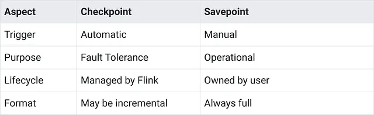

# When Flink State Goes Wrong: Checkpoints, Recovery & Fault Tolerance

Link: https://medium.com/@blakelassiter/when-flink-state-goes-wrong-checkpoints-recovery-fault-tolerance-7f0d9ab937d7

## Why Streaming Needs State

Consider what fraud detection needs to answer:
- **Velocity checks** — “Has this account had more than 5 transactions in the last 5 minutes?” Answering that requires knowing when previous transactions occurred.
- **Running totals** — “How much has this account spent today?” That’s an accumulation across events.
- **Pattern detection** — “Did a small test transaction happen right before this large purchase?” Card testing follows predictable patterns — a $1 charge to verify the card works, then a large fraudulent purchase. Detecting this requires remembering the small transaction long enough to correlate it with what comes next.

Without state, every transaction would be the first transaction. The velocity check would never trigger because there’s no history to check against. The running total would always equal just the current amount. Patterns would be invisible because the previous event is forgotten the moment processing completes.

## Two Types of State

Flink provides [two fundamental state types](https://nightlies.apache.org/flink/flink-docs-stable/docs/dev/datastream/fault-tolerance/state/#working-with-state):
- **Keyed state** is partitioned by key. When you call `keyBy(tx -> tx.getAccountId())`, Flink routes all events with the same account ID to the same task instance. That task maintains state only for the keys it handles. Account A's transaction history is separate from Account B's, potentially on different machines. The velocity check uses keyed state - each account has its own list of recent transactions.
- **Operator state** is per-parallel-instance rather than per-key. The primary use case is source connectors tracking their position in external systems — the Kafka connector uses operator state to track which partition offsets it has consumed. Another use case is broadcast state, where reference data (like a fraud blacklist) needs to be available to all parallel instances.

For application logic, keyed state handles most needs. Operator state rarely appears in application code directly.

### Keyed State in Practice

The velocity check needs a list of recent transaction timestamps per account. Flink’s `ListState<T>` handles this:

```java
public class VelocityCheckFunction 
    extends KeyedProcessFunction<String, Transaction, FraudAlert> {
    
    // State: list of recent transaction timestamps for this account
    private ListState<Long> recentTransactions;
    
    private static final int MAX_TRANSACTIONS = 5;
    private static final long WINDOW_MS = 5 * 60 * 1000; // 5 minutes
    
    @Override
    public void open(OpenContext openContext) throws Exception {
        // Initialize state descriptor - must happen in open(), not constructor
        ListStateDescriptor<Long> descriptor = new ListStateDescriptor<>(
            "recent-transactions",
            Long.class
        );
        recentTransactions = getRuntimeContext().getListState(descriptor);
    }
    
    @Override
    public void processElement(Transaction tx, Context ctx, Collector<FraudAlert> out) 
        throws Exception {
        
        long now = ctx.timestamp();  // Event time of current transaction
        
        // Clean up old transactions outside the window
        List<Long> current = new ArrayList<>();
        for (Long timestamp : recentTransactions.get()) {
            if (now - timestamp < WINDOW_MS) {
                current.add(timestamp);
            }
        }
        
        // Add current transaction
        current.add(now);
        recentTransactions.update(current);
        
        // Check velocity
        if (current.size() > MAX_TRANSACTIONS) {
            out.collect(new FraudAlert(
                tx.getAccountId(),
                "VELOCITY",
                "More than " + MAX_TRANSACTIONS + " transactions in 5 minutes"
            ));
        }
    }
}
```

Flink provides several keyed state types for different needs:
- **ValueState<T>** — a single value per key (current balance, latest timestamp)
- **ListState<T>** — a list per key (recent transactions, event sequences)
- **MapState<K,V>** — a map per key (per-merchant totals within an account)
- **ReducingState<T>** and **AggregatingState<IN,OUT>** — aggregated values with automatic combination

State descriptors must be created in `open()`, not in the constructor - the runtime context isn't available during construction. State access is synchronous - every read and write happens inline with event processing.

## State Backends — Where State Lives

State has to be stored somewhere. The [state backend](https://nightlies.apache.org/flink/flink-docs-stable/docs/ops/state/state_backends/) determines storage location and access characteristics.
- **HashMapStateBackend** keeps state in the JVM heap as Java objects. Reads and writes are fast because there’s no serialization during normal processing. The limitation is memory — when state grows larger than available heap, the job fails.
- **EmbeddedRocksDBStateBackend** stores state in [RocksDB](https://flink.apache.org/2021/01/18/using-rocksdb-state-backend-in-apache-flink-when-and-how/), an embedded key-value store that writes to local disk. State can grow larger than memory because RocksDB spills to disk. The tradeoff is speed — every state access requires serialization and deserialization.

    ```java
    env.setStateBackend(new EmbeddedRocksDBStateBackend());
    ```

    Or in `flink-conf.yaml`:
    
    ```yml
    state.backend.type: rocksdb
    state.checkpoints.dir: s3://my-bucket/checkpoints
    ```

Start with HashMapStateBackend for development and when state will stay small. Switch to RocksDB when state might grow large or when running jobs for extended periods.

## Checkpointing — Surviving Failures

Checkpointing periodically snapshots state so jobs can recover from failures without starting over.

The mechanism relies on checkpoint barriers — special markers that flow through the data stream alongside regular events. When the JobManager triggers a checkpoint, it injects barriers into the source operators. These barriers flow downstream through the same channels as data. When an operator receives barriers from all its input channels, it knows that all events before the barrier have been processed. At that point, the operator snapshots its current state to durable storage.

The barriers ensure consistency across the distributed job. Every operator snapshots at the same logical point in the stream — the moment when all pre-barrier events have been processed. When all operators complete their snapshots, the checkpoint succeeds.

```java
// Enable checkpointing every 60 seconds
env.enableCheckpointing(60000);

// Checkpoint must complete within 10 minutes
env.getCheckpointConfig().setCheckpointTimeout(600000);

// Only one checkpoint at a time
env.getCheckpointConfig().setMaxConcurrentCheckpoints(1);

// Preserve checkpoints on cancellation for recovery
env.getCheckpointConfig().setExternalizedCheckpointCleanup(
    ExternalizedCheckpointCleanup.RETAIN_ON_CANCELLATION
);

// Store checkpoints in S3
env.getCheckpointConfig().setCheckpointStorage("s3://my-bucket/flink-checkpoints/");
```

When using Kafka sources, the checkpoint includes the committed consumer offsets. On recovery, the job restarts from the checkpointed offsets. Combined with Kafka’s idempotent producers, this achieves end-to-end exactly-once semantics — events may be reprocessed during recovery, but state rollback ensures they produce identical results.

**Checkpoint storage location matters**. Checkpoints were configured and completing successfully — the metrics showed green. The storage path pointed to local disk on the TaskManager. When a TaskManager restarted, its local disk was wiped. The checkpoints were gone. So always use durable, shared storage for checkpoints — S3, GCS, HDFS — something that survives individual machine failures.

## Savepoints — Controlled Snapshots for Operations

Checkpoints handle automatic fault tolerance. Savepoints handle planned operations — upgrading job code, changing parallelism, migrating to a new cluster.



```bash
# Take a savepoint before upgrading
flink savepoint <job-id> s3://my-bucket/savepoints/

# Stop job cleanly with savepoint
flink stop --savepointPath s3://my-bucket/savepoints/ <job-id>

# Start new version from savepoint
flink run -s s3://my-bucket/savepoints/savepoint-abc123 my-job.jar
```

Adding new state variables works — the new state starts empty. Removing state works with the `--allowNonRestoredState` flag, telling Flink to ignore state that exists in the savepoint but not in the new code.

Changing state types is harder. If the old job stored `List<Long>` and the new job expects `List<TransactionRecord>`, Flink can't deserialize the old state into the new schema. Options include using Avro or Protobuf for state serialization (their schema evolution support handles many type changes) or accepting state loss for that variable and letting it rebuild from incoming events.

## State TTL — Preventing Unbounded Growth

[State TTL](https://nightlies.apache.org/flink/flink-docs-stable/docs/dev/datastream/fault-tolerance/state/#state-time-to-live-ttl) (time-to-live) automatically cleans up state that hasn’t been accessed within a configured period:

```java
ListStateDescriptor<Long> descriptor = new ListStateDescriptor<>(
    "recent-transactions",
    Long.class
);

StateTtlConfig ttlConfig = StateTtlConfig
    .newBuilder(Duration.ofHours(24))  // Expire after 24 hours of no access
    .setUpdateType(StateTtlConfig.UpdateType.OnReadAndWrite)
    .setStateVisibility(StateTtlConfig.StateVisibility.NeverReturnExpired)
    .cleanupFullSnapshot()  // Clean during checkpoints
    .build();
descriptor.enableTimeToLive(ttlConfig);
```

- **UpdateType.OnReadAndWrite** resets the TTL timer whenever state is accessed — active accounts stay alive. **UpdateType.OnCreateAndWrite** only resets on writes.
- **StateVisibility.NeverReturnExpired** ensures reads return empty rather than stale data, even if expired state hasn’t been physically cleaned up yet.
- **Cleanup strategies** determine when expired state gets removed. `cleanupFullSnapshot()` cleans during checkpoint creation. `cleanupInRocksdbCompactFilter(1000)` cleans incrementally during RocksDB compaction.

For the velocity check, 24-hour TTL means accounts with no activity for a day have their state removed automatically. The job tracks active accounts without unbounded growth.

## Backpressure — When State Operations Slow Things Down

If state operations slow an operator enough that it can’t keep up with incoming events, pressure builds upstream. Flink handles this through backpressure — slowing upstream operators to match the pace of slower downstream ones.

Common causes of backpressure in stateful jobs:
- Slow state access, especially with RocksDB on large state
- External service calls during processing
- Insufficient parallelism for the workload
- Uneven key distribution causing some tasks to handle disproportionate work

The [Flink Web UI](https://nightlies.apache.org/flink/flink-docs-stable/docs/ops/monitoring/back_pressure/) shows backpressure indicators for each task. High backpressure on an operator means that operator is a bottleneck. Checkpoint duration increasing over time can also signal building pressure — the job is falling behind.

Mitigation depends on the cause: increase parallelism for the bottleneck operator, use async I/O for external calls, tune RocksDB settings, or restructure hot keys.

Backpressure itself indicates Flink’s flow control working correctly. The concern is when it causes checkpoint timeouts or consumer lag growth — that means the job fundamentally can’t keep up with the input rate.

## The Complete Velocity Check

Here’s the `VelocityCheckFunction` with the production considerations - TTL configuration for cleanup and defensive handling of missing timestamps:

```java
public class VelocityCheckFunction 
    extends KeyedProcessFunction<String, Transaction, FraudAlert> {
    
    private ListState<Long> recentTransactions;
    
    private static final int MAX_TRANSACTIONS = 5;
    private static final long WINDOW_MS = 5 * 60 * 1000; // 5 minutes
    
    @Override
    public void open(OpenContext openContext) throws Exception {
        ListStateDescriptor<Long> descriptor = new ListStateDescriptor<>(
            "recent-transactions",
            Long.class
        );
        
        // Configure TTL to clean up inactive accounts
        StateTtlConfig ttlConfig = StateTtlConfig
            .newBuilder(Duration.ofHours(24))
            .setUpdateType(StateTtlConfig.UpdateType.OnReadAndWrite)
            .setStateVisibility(StateTtlConfig.StateVisibility.NeverReturnExpired)
            .cleanupInRocksdbCompactFilter(1000)
            .build();
        
        descriptor.enableTimeToLive(ttlConfig);
        recentTransactions = getRuntimeContext().getListState(descriptor);
    }
    
    @Override
    public void processElement(Transaction tx, Context ctx, Collector<FraudAlert> out) 
        throws Exception {
        
        long eventTime = ctx.timestamp();
        if (eventTime == Long.MIN_VALUE) {
            // No timestamp assigned - fall back to processing time
            eventTime = System.currentTimeMillis();
        }
        
        // Get current transactions and filter to window
        List<Long> current = new ArrayList<>();
        for (Long timestamp : recentTransactions.get()) {
            if (eventTime - timestamp < WINDOW_MS) {
                current.add(timestamp);
            }
        }
        
        // Add current transaction
        current.add(eventTime);
        recentTransactions.update(current);
        
        // Check velocity threshold
        if (current.size() > MAX_TRANSACTIONS) {
            out.collect(new FraudAlert(
                tx.getAccountId(),
                "VELOCITY", 
                String.format(
                    "%d transactions in %d minutes (threshold: %d)",
                    current.size(),
                    WINDOW_MS / 60000,
                    MAX_TRANSACTIONS
                )
            ));
        }
    }
}
```